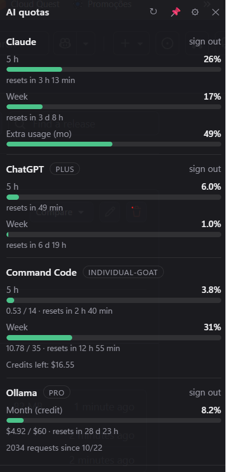

# Quota Widget

A small always-on-top Windows widget that shows your AI usage quotas across providers in one place. One bar per usage window, with a countdown to the next reset.

Currently supported: **Claude**, **ChatGPT (Codex)**, **Command Code**, **Ollama**, **OpenRouter**, **DeepSeek**, **Moonshot (Kimi)**, **GitHub Copilot**, **Synthetic**, **NanoGPT**, **OpenAI API**, **Anthropic API**, **xAI (Grok)**, **Mistral** and **OpenCode Go**. Adding a provider is a single file, see [CONTRIBUTING.md](CONTRIBUTING.md).

> Also available in: [Português (pt-BR)](docs/README.pt-BR.md) · [Español](docs/README.es.md)

<p align="center"></p>

## Features

- One card per service, with colored bars (green, amber, red) and "resets in…" countdowns.
- Settings screen: one row per service with an on/off switch and a status, opening a detail view for that service's usage windows, key fields, per-service refresh interval and diagnostics; plus refresh interval, language, always-on-top, start with Windows, notifications, skins (Classic/Paper), layout (floating card or dock) and custom providers (guided form or JSON spec, templates and import/export).
- Each service can override the global refresh interval. Failed updates back off exponentially (up to 60 minutes), while the last reading stays visible marked stale.
- Optional notifications at 90% and on renewal, with a mute switch in Settings and the tray.
- System tray icon; the window remembers its position.
- Everything runs locally. All app data lives under `~/.quotawidget/`: `config.json`, the encrypted-custom-provider blob and the per-provider sign-in profiles in `profiles/`. Claude and ChatGPT sign-ins live in isolated Electron sessions there. API keys and custom-provider specs are stored locally and encrypted with Windows (Electron `safeStorage`, tied to your Windows user); `~/.quotawidget/config.json` only contains the encrypted blobs, never the values in plain text. Nothing is sent anywhere except to the services themselves.

## Install

Download `Quota-Widget-Setup-<version>.exe` from the [Releases](../../releases) page and run it. No admin rights needed.

The installer is **not code-signed**, so Windows SmartScreen may warn on first run: click *More info*, then *Run anyway*. If you would rather not run a downloaded installer, build it yourself (below): a locally built app never triggers that warning.

## Build from source

Requires Node.js 20+, Git and Windows. No admin rights or extra build tools.

```bash
git clone https://github.com/edilsondjr/ai-quota-widget.git
cd ai-quota-widget
npm install
npm test            # unit tests (parsers, settings, locales, expressions)
npm run test:e2e    # Electron UI test on Windows
npm start           # run from source
npm run dist        # build the installer into dist/
```

The build also leaves a ready-to-run copy in `dist/win-unpacked/`. The release installer is built by GitHub Actions from a `v*` tag. More detail, silent install and troubleshooting: [docs/BUILDING.md](docs/BUILDING.md).

## Where the data comes from

Most of these services do not offer an official quota API for subscriptions, so the widget reads the same endpoints their own sites and CLIs use, or the documented balance APIs where they exist. **They can change or break at any time.**

| Service | Source | Auth |
|---|---|---|
| Claude | `claude.ai/api/organizations/<org>/usage` | Sign in once via the **Sign in** button |
| ChatGPT | `chatgpt.com/backend-api/wham/usage` (same route the Codex CLI uses) | Sign in via the button |
| Ollama | `ollama.com/api/usage` (API key, monthly USD credit) | API key in Settings |
| Command Code | `api.commandcode.ai/alpha/billing/credits` + `/alpha/usage/summary` + `/alpha/billing/subscriptions` | API key in Settings |
| OpenRouter | `openrouter.ai/api/v1/key` (documented) | API key in Settings |
| DeepSeek | `api.deepseek.com/user/balance` (documented) | API key in Settings |
| Moonshot (Kimi) | `api.moonshot.ai/v1/users/me/balance` (documented) | API key in Settings |
| GitHub Copilot | `api.github.com/users/<user>/settings/billing/premium_request/usage` (documented) | Token, username and monthly allowance in Settings |
| Synthetic | `api.synthetic.new/v2/quotas` (documented) | API key in Settings |
| NanoGPT | `nano-gpt.com/api/management/v1/subscription/usage` (documented) | Usage-only management token in Settings |
| OpenAI API | `api.openai.com/v1/organization/costs` (documented) | Admin API key in Settings |
| Anthropic API | `api.anthropic.com/v1/organizations/cost_report` (documented) | Admin API key in Settings |
| xAI (Grok) | `management-api.x.ai/v1/billing/teams/<team>/usage` (documented) | Management key and team ID in Settings |
| Mistral | `api.mistral.ai/v1/billing/usage` + `/v1/billing/subscription` | API key with billing access |
| OpenCode Go | `opencode.ai/zen/go/v1/usage` (console endpoint) | Go API key in Settings |

Each provider lives in its own file under [`providers/`](providers), so a broken endpoint is a one-file fix.

Notes:

- Only **Claude** and **ChatGPT** use browser sign-in. Every other service uses an API key in Settings.
- Google/Apple sign-in inside an embedded window is often refused by the provider. Use email code/link sign-in instead.
- Ollama's newer plans meter a monthly USD credit (Pro $60, Max $300), not session/weekly limits. Set the renewal day in Settings if the estimate is off.
- Unknown internal limits returned by Claude are hidden by default; you can show them in Settings.
- OpenRouter shows the key's credit limit (with its daily/weekly/monthly reset) and the free-model daily requests; a key with no limit shows the month's spend instead.
- DeepSeek and Moonshot report a balance, not a percentage, so their cards show a balance line and no bars.
- GitHub Copilot needs a token that can read your billing data, your username, and the premium-request allowance of your plan (Pro = 300). Licenses managed by an organization or enterprise are not covered by that endpoint.
- Command Code's monthly window is computed from the billing-period spend (`/alpha/usage/summary?since=currentPeriodStart`) plus the remaining monthly/purchased/free credits, resetting at `currentPeriodEnd` from `/alpha/billing/subscriptions`. The credits endpoint alone has no monthly window.
- Synthetic, NanoGPT and OpenCode Go show usage windows; OpenAI API, Anthropic API, xAI and Mistral show a monthly cost/usage line instead of bars.
- Anthropic's cost report returns amounts in cents; the widget converts them to dollars.
- Mistral uses its billing endpoints (`/v1/billing/usage` and `/v1/billing/subscription`). The documented admin `/v1/admin/usage` response is a raw usage/price catalog without a simple total.
- OpenCode's `/zen/go/v1/usage` is the endpoint used by its console and covers OpenCode Go plans only; it is not yet in the public Go docs.
- If an update fails, the card keeps the last successful reading and shows a stale notice instead of going blank on a transient error.

## Skins

**Settings → Appearance** offers built-in skins:

- **Classic** — the current dark widget.
- **Paper** — a light, editorial skin with serif headings, square rules and a paper background.

Selecting a skin previews it live; **Save** persists it and **Cancel** reverts to the saved skin. The tray menu also has a **Skin** submenu. Skins are CSS-only, apply to the widget card, and leave the Settings screen readable. The choice lives in `config.json` and is included in backup/export.

## Layout and dock

**Settings → Appearance → Layout** chooses between:

- **Card** — the floating 336px widget.
- **Dock** — an edge overlay with the position **Top**, **Left** or **Right**.

The top dock is a horizontal strip of the enabled providers. Each provider shows its name and plan at the left and its usage windows in a compact column at the right, with the note below. The side dock is a full-height vertical rail with the full provider cards. The gear opens Settings in a 360px panel; closing it restores the dock.

The dock is an always-on-top edge overlay; it does not reserve screen space like a native Windows AppBar. Auto-hide, multi-monitor pinning and drag-to-dock are not part of this version. The Classic and Paper skins apply to the dock as well.

## Custom providers

If a service is not built in, add it in **Settings → Custom providers → Add custom provider**. New providers open in the guided form: name, URL, method, auth, optional headers/body, one or more usage windows, note values and a plan path. Use **Add window** / **Add note value** for providers with multiple limits. Use **Template** to pick a starting point, then **Apply template** to replace the mapping (windows, note values and plan); the name, URL, auth, headers, body and API key stay unchanged. Changing the selection alone does not touch the form. Use **Copy JSON** / **Load JSON** to move a spec between machines. The API key is never included in the copied spec.

**JSON** remains available for exact editing. Use **Test** before saving to fetch the URL and preview the parsed windows/note, or see the error; Test does not create the provider.

```json
{
  "name": "My provider",
  "url": "https://api.example.com/usage",
  "method": "GET",
  "auth": "bearer",
  "headers": { "Accept": "application/json" },
  "mapping": {
    "windows": [
      { "key": "month", "label": "Month", "percent": "data.used_percent", "resetsAt": "data.reset_at", "detail": "data.detail" }
    ],
    "note": { "template": "Balance: {amount}", "values": { "amount": "data.balance" } },
    "plan": "data.plan"
  }
}
```

- `auth`: `bearer` (default), `header` (set `authHeader` and `authPrefix`), or `none`.
- `method`: `GET` or `POST`; for `POST`, `body` is a JSON string.
- Paths use dots; arrays use `items[0].value`. `scale: "fraction"` multiplies the value by 100.
- Each window needs `key` and `percent`; `label`, `resetsAt` and `detail` are optional.
- A note template can use `{name}` values resolved from `mapping.note.values`, and can span multiple lines: press Enter in the guided editor or use `\n` in JSON.
- The provider must return JSON over HTTPS (HTTP is allowed only for localhost); requests time out after 15 seconds.
- The whole spec, including `headers` and `body`, is encrypted at rest in `~/.quotawidget/config.json` (`customProvidersEnc`). Prefer the API key field for secrets; the spec is encrypted as defense in depth.

### Safe expressions

Any mapping value can be a path or a safe expression starting with `=`. Expressions are evaluated by a small whitelist, not by `eval`/`Function`, so a spec cannot access Node APIs.

- `data` is the whole response; top-level keys also work directly.
- Math: `round`, `floor`, `ceil`, `abs`, `min`, `max`, `pow`, `sqrt`.
- Functions: `Number`, `String`, `Boolean`, `parseInt`, `parseFloat`, `isFinite`.
- Methods: `toFixed`, `toLocaleString`, `trim`, `toUpperCase`, `toLowerCase`.
- Operators: `+ - * / % **`, comparisons, `&& || !`, ternary `? :`.
- Not available: `require`, `process`, `Function`, constructors, assignment or loops.

For a response like:

```json
{
  "credits": { "type": "usd", "usd": 0.0 },
  "subscription": {
    "type": "generations",
    "status": "active",
    "plan": "Tier 3: Pixel Architect",
    "generations": 3101.99999999999,
    "total": 9000.0
  }
}
```

use paths for plain values and expressions for formatting or calculation:

```json
{
  "name": "My provider",
  "url": "https://api.example.com/usage",
  "auth": "bearer",
  "mapping": {
    "plan": "subscription.plan",
    "windows": [
      {
        "key": "generations",
        "label": "Generations",
        "percent": "=data.subscription.generations / data.subscription.total * 100",
        "detail": "=Math.round(data.subscription.generations) + ' / ' + data.subscription.total"
      }
    ],
    "note": {
      "template": "Balance: {balance}",
      "values": {
        "balance": "=Math.round(data.subscription.generations).toLocaleString(\"en-US\")"
      }
    }
  }
}
```

This produces a ~34.5% bar and `Balance: 3,102`. The editor's **?** button opens the same reference.

## Backup and restore

**Settings → Configuration** can:

- **Back up config** — copy the encrypted `config.json` to `~/.quotawidget/backups/` (the last 10 are kept).
- **Export config** — save the encrypted config to a JSON file.
- **Import config** — restore a previous export. Files with plaintext keys or custom specs are rejected, a backup of the current config is created first, and the app restarts.
- **Reset settings** — remove settings, keys and custom providers after a backup, and disable start with Windows.

Config version 2 stores custom-provider specs in `customProvidersEnc`. Existing plaintext `customProviders` configs are migrated automatically, and a backup is created before a version migration.

## Privacy and responsibility

The widget only talks to the services above, using your own account. It does not collect telemetry. Accessing undocumented endpoints may be against a provider's terms of service; use it at your own risk and only with your own accounts.

This project is independent and not affiliated with, endorsed by, or sponsored by any of the services listed above. All product names are trademarks of their owners.

## Contributing

Issues and pull requests are welcome, especially fixes when an endpoint changes. See [CONTRIBUTING.md](CONTRIBUTING.md). Never paste real API keys, cookies or tokens into issues.

## License

[MIT](LICENSE). Made by [BeamGlyph](https://www.beamglyph.com).
